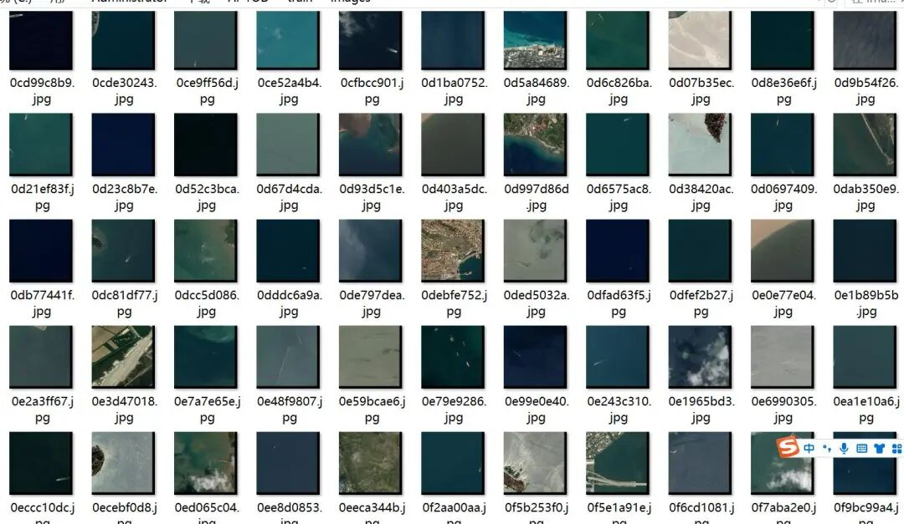
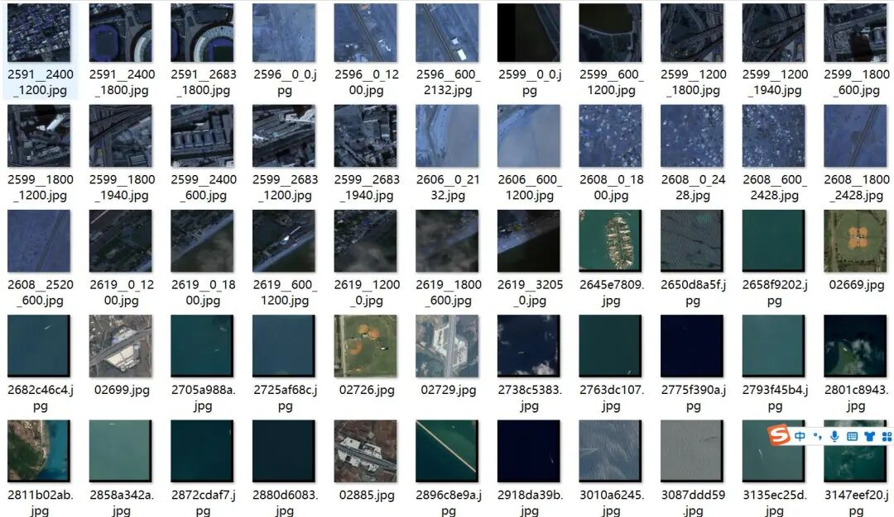
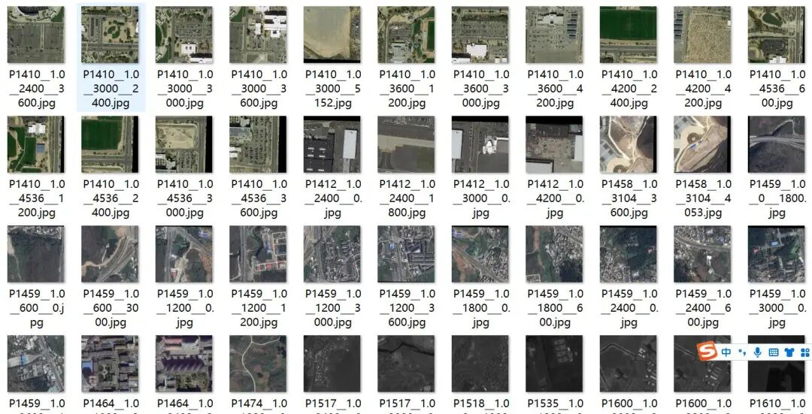
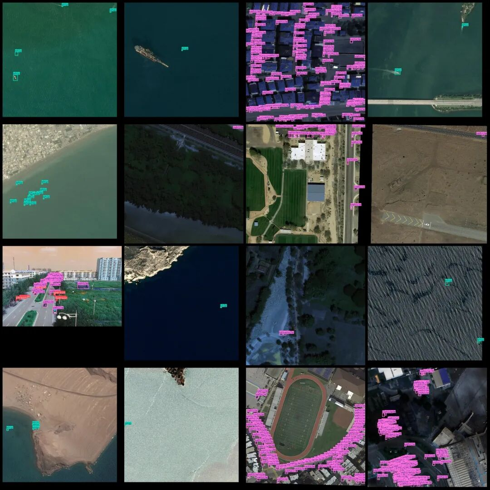
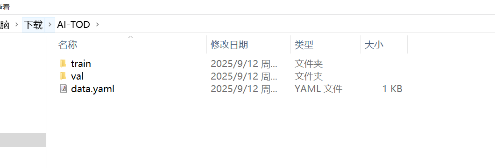
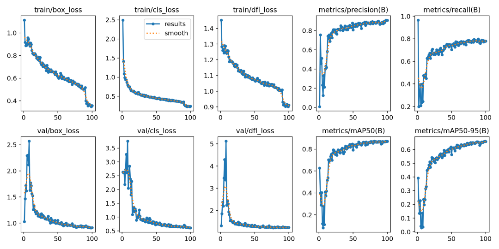

# Hyper-octane AI-TOD detection dataset for tiny targets in compressed lossless YOLO format with 14018 images across 8 categories

[Dataset Introduction]

We have built AI-TOD based on publicly available large-scale aviation image datasets, which include: DOTA-v1.5 training/validation set [1], xView training set [19], VisDrone2018-Det training/validation set [20], Airbus Ship training/validation set 1, and DIOR training/validation+test set [3]. The detailed information of these datasets is as follows:

DOTA-v1.5 Training/Validation Set: This is an upgraded version of the original DOTA-v1.0 dataset [1] and has been used for performance evaluation in Aerial Image Object Detection (DOAI2019). The DOTA-v1.5 training/validation set consists of 1,869 images with sizes ranging from 800 × 800 to 4000 × 4000 pixels, as well as 280,196 target instances labeled into 16 categories (e.g., ships, small vehicles, tanks).

xView training set: This is a large-scale target detection dataset, comprising 1,415 square kilometers of WorldView-3 images with a resolution of 30 centimeters. The labeled dataset is used for target detection, covering over 1 million target instances in more than 60 categories, including various types of vehicles, aircraft, and ships [19].

VisDrone2018-Det training and validation set. This dataset consists of 7,019 images captured by drone platforms at various locations and heights. The images are manually labeled, including bounding boxes and 10 predefined categories (e.g., pedestrians, people, cars).

Airbus-Ship training and validation set. This is a dataset for ship detection in Kaggle challenges. The Airbus-Ship training and validation set consists of 42,559 images and 81,724 ships, all labeled with polygons.

DIOR training validation + test set. The dataset contains 23,463 images and 192,472 target instances, covering 20 categories (e.g., airplanes, ships, windmills).

To build the AI-TOD dataset, we extract images and object instances from the aforementioned dataset, with the following specific steps:

Image Size. The original image is divided into 800×800 pixel blocks, with overlapping areas of 200 pixels. If the original image is less than 800×800 pixels, it is extended to 800×800 pixels by filling in zero pixels.
Object Type. We have selected eight categories from the AI-TOD dataset, including airplane (AI), bridge (BR), storage tank (ST), ship (SH), swimming pool (SP), vehicle (VE), person (PE), and windmill (WM). The selection of these categories was based on whether a particular object type is common in low-resolution aerial images and its size.airplane (AI), bridge (BR), storage-tank (ST), ship (SH), swimming-pool (SP), vehicle (VE)
Category Conversion. After selecting a category, we convert the old category in the corresponding dataset to the new category. During this process, some categories not present in the AI-TOD are eliminated.

Image Preview:

 Editor

 Edited Edited

Annotation example:

 Edit

The official dataset size is 22GB and it is not in YOLO format by default. Here, we will compress the official images into JPG format without loss of quality and convert them into YOLO format. The compression package will become 1.08GB in size, greatly saving download time while not affecting training results.

[Training Steps]

Here we take the example of training with YOLOv11. First, we obtain the dataset in a 7z or zip format and unzip it into a non-Chinese or space-free path. For instance, unzip it to the C:\Users\Administrator\Downloads directory, where the following training process is demonstrated.

 Edit

Open coco128.yaml and see the following format:

```
train: train/images
val: val/images
# Number of classes
nc: 8
# Class names
names:
  0: airplane
  1: bridge
  2: storage-tank
  3: ship
  4: swimming-pool
  5: vehicle
  6: person
  7: wind-mill
```

These do not need to be modified; we only need to check if they are correct.

Afterwards, it's time to start training. Note that you need to have your Yolov11 model environment set up beforehand for training.

Start training with a pre-trained model.

yolo task=detect mode=train model=yolo11n.pt data=coco128.yaml epochs=100 imgsz=640 batch=8 workers=2

Parameters Description:

Model: The type of model used, such as yolo11s.pt (small model), yolo11m.pt (medium), yolo11l.pt (large)
Data: Specifies the data configuration file
Epochs: Number of training rounds
Imgsz: Input image size
Batch: Batch size (adjusted according to memory capacity)

Workers: Specify the number of processes (Windows is best to set 0, 1, or 2; Linux can set 8).
After training, the best weight save path is: runs/detect/train/weights/best.pt. If multiple runs are executed by running commands runs/detect/train2 and runs/detect/train3, you only need to go to the folder with the highest number to find the model.

Image prediction:

```
from ultralytics import YOLO
# Load the trained model
model = YOLO('runs/detect/train/weights/best.pt')
# Image Prediction
results = model('path_to_your_image.jpg')

```

Video or camera prediction

```
results = model('path_to_video.mp4') # video
[#results] = model(0) # Camera

```

Validation set evaluation

```
yolo task=detect mode=val model=runs/detect/train/weights/best.pt data=data.yaml

```

Output the indicator image, usually generated after model training, located at runs/detect/train/results.png:

 Edit

Introduction to commonly used evaluation parameters in the above training results images.

[Common Evaluation Parameters Introduction]

In the task of object detection, evaluating the performance of a model is crucial. The terms you mentioned are commonly used metrics for assessing model performance. Here are detailed explanations of these terms:

1.

1. **Class**

: 

-

-

This usually refers to the categories of objects that the model is designed to detect. For example, a model may be trained to detect different categories of objects such as vehicles, pedestrians, or animals.

-

1.

1. **Images**

: 

-

-

Represents the number of images in the validation set. The validation set is a dataset used to evaluate model performance, separate from the training set to ensure impartiality in evaluation results.

-

1.

1. **Instances**

: 

-

-

The total number of target objects in all images. This includes the sum of all category objects, for example, if the validation set contains 100 images, each image has an average of 5 target objects, then the Instances is 500.

-

1.

1. **P (Precision)**

: 

-

-

Precision is the proportion of actual positive samples predicted by the model. The formula is: Precision = TP / (TP + FP), where TP represents true positives (True Positives) and FP represents false positives (False Positives).

-

1.

1. **R (Recall)**

: 

-

-

Recall is the proportion of all true positives correctly predicted by the model. The formula is: Recall = TP / (TP + FN), where FN represents false negatives.

-

1.

1. **mAP50**

: 

-

-

Mean Average Precision (mAP) at an IoU threshold of 0.5, where IoU is the metric used to measure the degree of overlap between predicted bounding boxes and ground truth bounding boxes. mAP is a comprehensive metric that considers both precision and recall when evaluating model performance across different recall levels. At an IoU of 0.5, if the overlap between the predicted bounding box and the ground truth bounding box reaches or exceeds 50%, it is considered correct.

-

1.

1. **mAP50-95**

: 

-

-

This represents the average accuracy of the model across a range of IoU values from 0.5 to 0.95 (with an interval of 0.05). This is a more stringent evaluation criterion, demanding higher overlap between predicted bounding boxes and true ones. In object detection tasks, higher IoU thresholds mean that models need to be more accurate in their target object localization. The calculation of mAP50-95 takes into account multiple IoU thresholds ranging from lenient to strict, thus providing a more comprehensive assessment of model performance.

-

These indicators collectively form an important framework for evaluating the performance of target detection models. By comparing the performance of different models on these indicators, it can be determined which model may be more effective in practical applications.

Export the model to ONNX, TensorRT, etc. for deployment:

yolo export model=runs/detect/train/weights/best.pt format=onnx
Supported formats include: onnx, engine, tflite, pb, torchscript, etc.

After the above training, the model can be further deployed, such as using ONNX models for embedded deployment, using Engine models for DeepStream deployment on Jetson, and using TorchScript models for deployment on C++, etc.


## Payment

Here is a pay link on Stripe ( https://buy.stripe.com/3cs8yP7sY87d0vu9AB ). Please contact me lonlonago@foxmail.com after funding $89, and I will send you a complete data files , thank you!


